# 基于springboot的房屋租赁系统

> 🎓 **计算机毕业设计 · 基于springboot的房屋租赁系统**
>
> 本仓库只放**项目介绍 + 运行截图**（截图是站点带水印的原图，存在仓库 `images/` 里）。
>
> 👉 **完整可运行源码 / 数据库脚本 / 部署文档：[点我获取](https://geekcode.top/archives/%E5%9F%BA%E4%BA%8Espringboot%E7%9A%84%E6%88%BF%E5%B1%8B%E7%A7%9F%E8%B5%81%E7%B3%BB%E7%BB%9F?utm_source=github)**
>
> 💬 咨询微信：**ir9372**　|　🌐 更多项目：[极客代码 geekcode.top](https://geekcode.top/?utm_source=github)
>
> 📌 项目详情页：<https://geekcode.top/archives/%E5%9F%BA%E4%BA%8Espringboot%E7%9A%84%E6%88%BF%E5%B1%8B%E7%A7%9F%E8%B5%81%E7%B3%BB%E7%BB%9F?utm_source=github>

<table><td width="230" align="center"> <b>扫码加微信 ir9372</b></td><td valign="middle">📦 源码 = 项目介绍 + 全部运行截图 + 数据库 + 部署文档 👉 点上方任意截图，直接跳到 <b>极客代码 geekcode.top</b> 详情页</td></table>

---

<h1>基于springboot的房屋租赁系统</h1>
<h2>项目概述</h2>

房屋租赁管理系统面向房屋租赁业务管理，提供前台信息浏览和后台业务管理。核心功能包括公告信息、房屋信息、户主、租客、看房申请、租赁合同、收租信息、收租统计、维修数据、报修信息等模块管理。前台用户可注册登录并浏览公告与房屋信息，进入个人中心；后台管理员可维护租赁业务数据并查看统计。系统采用 Spring Boot 构建后端服务，MyBatis-Plus 完成数据访问，Shiro 提供认证授权，MySQL 存储业务数据，前端采用 Vue 集成方式，适用于房屋管理、租赁档案维护与日常业务查询场景。

<h2>技术架构</h2>
<h3>前后端架构</h3>

系统采用前端页面与后端服务协同的集成架构。前端页面通过 HTTP 请求调用 Spring Boot 控制器接口，后端控制器负责接收请求、处理业务逻辑并返回数据。权限控制由 Shiro 提供，数据访问层由 MyBatis-Plus 与 MySQL 驱动协同完成。

<a href="https://geekcode.top/archives/%E5%9F%BA%E4%BA%8Espringboot%E7%9A%84%E6%88%BF%E5%B1%8B%E7%A7%9F%E8%B5%81%E7%B3%BB%E7%BB%9F?utm_source=github" title="查看完整源码">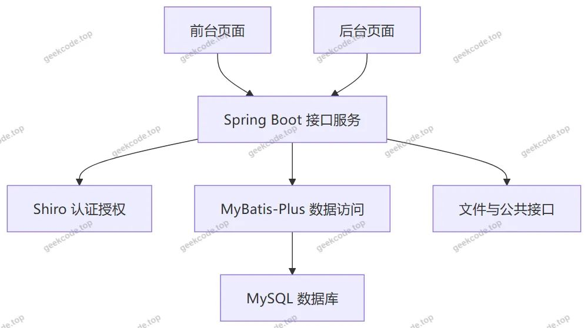</a>

后端控制器覆盖房屋信息、公告信息、户主、租客、维修数据、报修信息、租赁合同、看房申请、收租信息、收租统计等业务模块，同时包含用户、配置、文件、公共接口等支撑模块。

<h3>数据库设计要点</h3>

数据库围绕房屋租赁业务对象组织数据，主要业务实体包括用户、房屋信息、公告信息、户主、租客、维修数据、报修信息、租赁合同、看房申请、收租信息、收租统计、配置和文件。

<a href="https://geekcode.top/archives/%E5%9F%BA%E4%BA%8Espringboot%E7%9A%84%E6%88%BF%E5%B1%8B%E7%A7%9F%E8%B5%81%E7%B3%BB%E7%BB%9F?utm_source=github" title="查看完整源码">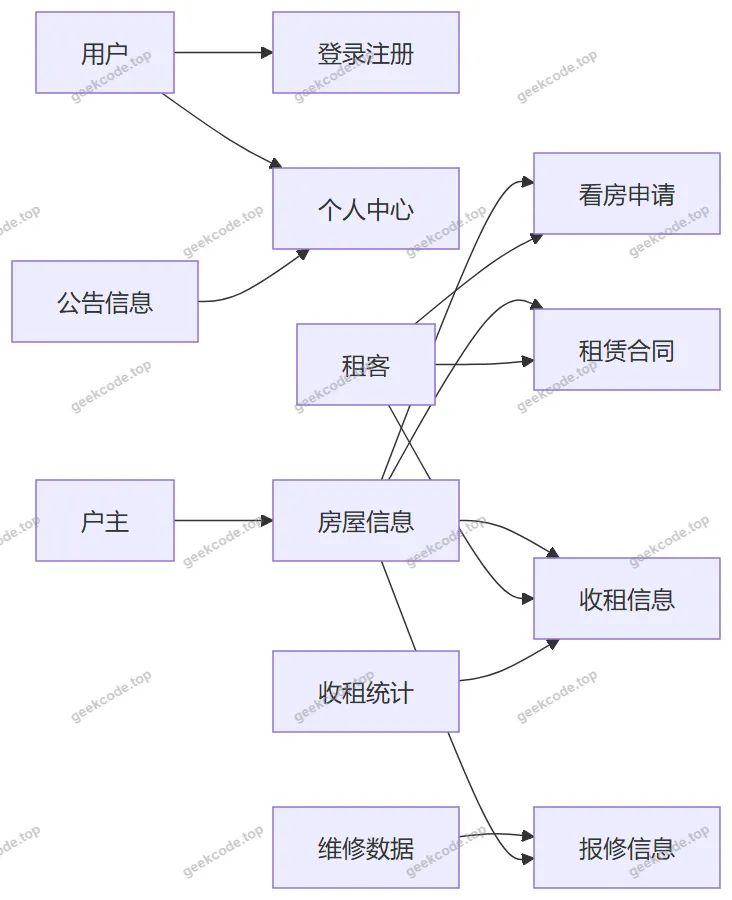</a>

数据关系以房屋信息为核心，户主与房屋信息形成房源归属关系，房屋信息与看房申请、租赁合同、收租信息、报修信息形成业务关联。租客与看房申请、租赁合同、收租信息形成租赁业务关联。维修数据为报修信息提供基础数据支撑，收租统计基于收租信息形成汇总结果，公告信息面向前台展示。

<h3>核心技术选型理由</h3>
<ul>
<li>Spring Boot：用于快速构建 Web 服务，提供自动配置、内嵌容器和接口开发能力。</li>
<li>MyBatis-Plus：用于简化数据库访问，支持通用 CRUD 操作和条件构造，提升业务模块开发效率。</li>
<li>Shiro：用于实现登录认证、权限控制和会话管理，保障前后台访问安全。</li>
<li>MySQL：用于存储房屋、公告、户主、租客、合同、收租、报修等业务数据。</li>
<li>Vue 集成前端：用于组织前台页面和后台管理页面，与后端接口进行数据交互。</li>
<li>validation-api：用于接口参数校验，保障请求数据格式正确。</li>
<li>commons-lang3：用于字符串、对象处理等基础工具支持。</li>
<li>protobuf-java：作为底层依赖组件，提供数据处理与序列化支持能力。</li>
</ul>
<h2>功能模块</h2>
<h3>前台用户端</h3>
<table>
<thead>
<tr>
<th>模块</th>
<th>功能内容</th>
</tr>
</thead>
<tbody><tr>
<td>前台首页</td>
<td>提供系统前台入口，承载公告信息、房屋信息和个人中心导航</td>
</tr>
<tr>
<td>前台登录页</td>
<td>提供前台用户身份认证入口</td>
</tr>
<tr>
<td>前台注册页</td>
<td>提供前台用户账号创建入口</td>
</tr>
<tr>
<td>公告信息列表</td>
<td>展示公告信息内容</td>
</tr>
<tr>
<td>房屋信息列表</td>
<td>展示房屋信息内容</td>
</tr>
<tr>
<td>个人中心</td>
<td>提供个人中心功能入口</td>
</tr>
</tbody></table>
<h3>后台管理端</h3>
<table>
<thead>
<tr>
<th>模块</th>
<th>功能内容</th>
</tr>
</thead>
<tbody><tr>
<td>后台登录页</td>
<td>提供后台管理员身份认证入口</td>
</tr>
<tr>
<td>后台首页</td>
<td>提供后台功能总览入口</td>
</tr>
<tr>
<td>房屋信息管理</td>
<td>维护房屋信息数据</td>
</tr>
<tr>
<td>公告信息管理</td>
<td>维护公告信息数据</td>
</tr>
<tr>
<td>户主管理</td>
<td>维护户主档案数据</td>
</tr>
<tr>
<td>租客管理</td>
<td>维护租客档案数据</td>
</tr>
<tr>
<td>维修数据管理</td>
<td>维护维修基础数据</td>
</tr>
<tr>
<td>报修信息管理</td>
<td>维护报修记录数据</td>
</tr>
<tr>
<td>租赁合同管理</td>
<td>维护租赁合同记录</td>
</tr>
<tr>
<td>看房申请管理</td>
<td>维护看房申请记录</td>
</tr>
<tr>
<td>收租信息管理</td>
<td>维护收租记录数据</td>
</tr>
<tr>
<td>收租统计</td>
<td>展示收租统计结果</td>
</tr>
<tr>
<td>配置管理</td>
<td>维护系统配置数据</td>
</tr>
<tr>
<td>文件管理</td>
<td>提供文件上传与访问接口</td>
</tr>
<tr>
<td>公共接口</td>
<td>提供通用数据接口能力</td>
</tr>
<tr>
<td>用户管理</td>
<td>维护系统用户基础数据</td>
</tr>
</tbody></table>
<h2>用户角色与权限</h2>
<table>
<thead>
<tr>
<th>角色</th>
<th>可访问功能模块</th>
</tr>
</thead>
<tbody><tr>
<td>前台用户</td>
<td>前台首页、前台登录、前台注册、公告信息列表、房屋信息列表、个人中心</td>
</tr>
<tr>
<td>后台管理员</td>
<td>后台登录、后台首页、房屋信息管理、公告信息管理、户主管理、租客管理、维修数据管理、报修信息管理、租赁合同管理、看房申请管理、收租信息管理、收租统计、配置管理、文件管理、公共接口、用户管理</td>
</tr>
<tr>
<td>业务档案对象</td>
<td>户主、租客作为后台管理对象，由后台管理员维护，不单独对应前台或后台登录入口</td>
</tr>
</tbody></table>
<h2>项目特色与创新点</h2>
<ul>
<li>业务链路覆盖完整：系统围绕房屋租赁业务组织模块，包含房屋信息、公告信息、户主、租客、看房申请、租赁合同、收租信息、收租统计、维修数据、报修信息等管理内容。</li>
<li>前台展示与后台管理结合：前台提供公告信息和房屋信息浏览能力，后台提供业务数据维护与统计查看能力。</li>
<li>权限控制保障访问安全：使用 Shiro 实现认证授权，区分前台用户入口和后台管理入口。</li>
<li>数据访问效率较高：使用 MyBatis-Plus 支撑各业务模块的数据库访问，减少重复性持久层代码。</li>
<li>系统支撑能力较完善：包含配置管理、文件管理、公共接口和用户管理等基础支撑模块，为业务功能提供后台服务支持。</li>
</ul>
<h2>部署环境</h2>
<table>
<thead>
<tr>
<th>软件环境</th>
<th>用途</th>
</tr>
</thead>
<tbody><tr>
<td>JDK</td>
<td>运行 Spring Boot 后端服务</td>
</tr>
<tr>
<td>MySQL</td>
<td>存储业务数据</td>
</tr>
<tr>
<td>Maven 或 Gradle</td>
<td>管理项目依赖与构建后端工程</td>
</tr>
<tr>
<td>Node.js</td>
<td>构建 Vue 集成前端资源</td>
</tr>
<tr>
<td>浏览器</td>
<td>访问前台页面和后台管理页面</td>
</tr>
<tr>
<td>IDE</td>
<td>进行开发、调试和代码维护</td>
</tr>
</tbody></table>
<h2>五、技术特性</h2>
<ul>
<li>前后端集成部署，前端资源打包至后端 static 目录</li>
<li>使用 MyBatis-Plus 简化数据访问层开发</li>
<li>集成 Shiro 权限框架实现角色权限控制</li>
</ul>
<h2>六、功能模块截图</h2>
<h3>前台用户端</h3>
<h4>前台首页</h4>

<a href="https://geekcode.top/archives/%E5%9F%BA%E4%BA%8Espringboot%E7%9A%84%E6%88%BF%E5%B1%8B%E7%A7%9F%E8%B5%81%E7%B3%BB%E7%BB%9F?utm_source=github" title="查看完整源码">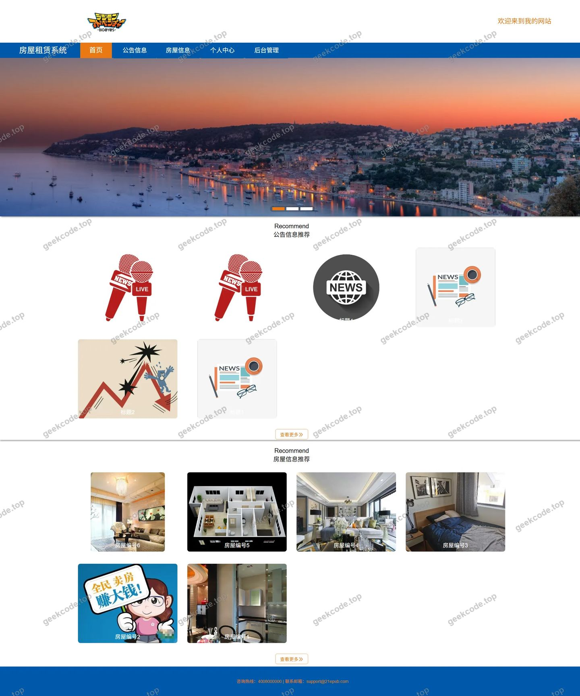</a>

<h4>前台登录页</h4>

<a href="https://geekcode.top/archives/%E5%9F%BA%E4%BA%8Espringboot%E7%9A%84%E6%88%BF%E5%B1%8B%E7%A7%9F%E8%B5%81%E7%B3%BB%E7%BB%9F?utm_source=github" title="查看完整源码">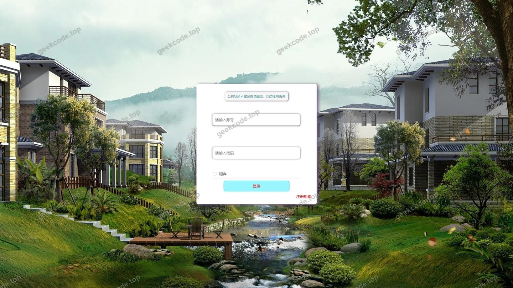</a>

<h4>前台注册页</h4>

<a href="https://geekcode.top/archives/%E5%9F%BA%E4%BA%8Espringboot%E7%9A%84%E6%88%BF%E5%B1%8B%E7%A7%9F%E8%B5%81%E7%B3%BB%E7%BB%9F?utm_source=github" title="查看完整源码">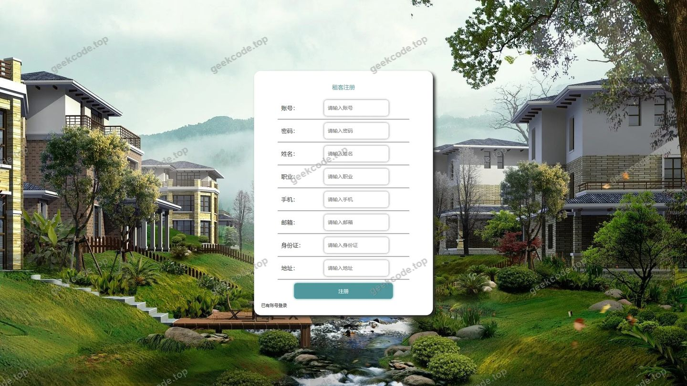</a>

<h4>前台-房屋信息列表</h4>

<h4>前台-公告信息列表</h4>

<h3>后台管理端</h3>
<h4>后台-报修信息</h4>

<a href="https://geekcode.top/archives/%E5%9F%BA%E4%BA%8Espringboot%E7%9A%84%E6%88%BF%E5%B1%8B%E7%A7%9F%E8%B5%81%E7%B3%BB%E7%BB%9F?utm_source=github" title="查看完整源码">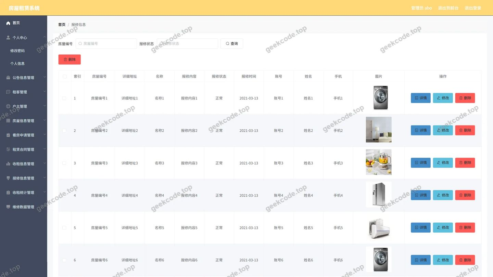</a>

<h4>后台-房屋信息</h4>

<a href="https://geekcode.top/archives/%E5%9F%BA%E4%BA%8Espringboot%E7%9A%84%E6%88%BF%E5%B1%8B%E7%A7%9F%E8%B5%81%E7%B3%BB%E7%BB%9F?utm_source=github" title="查看完整源码">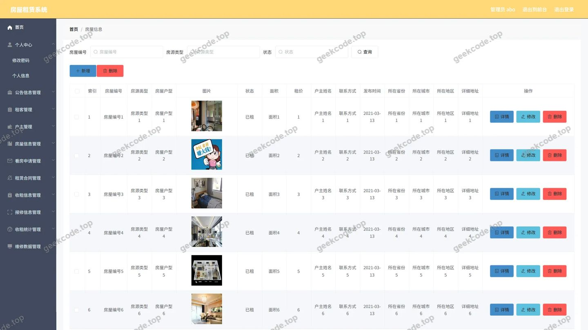</a>

<h4>后台-公告信息</h4>

<a href="https://geekcode.top/archives/%E5%9F%BA%E4%BA%8Espringboot%E7%9A%84%E6%88%BF%E5%B1%8B%E7%A7%9F%E8%B5%81%E7%B3%BB%E7%BB%9F?utm_source=github" title="查看完整源码">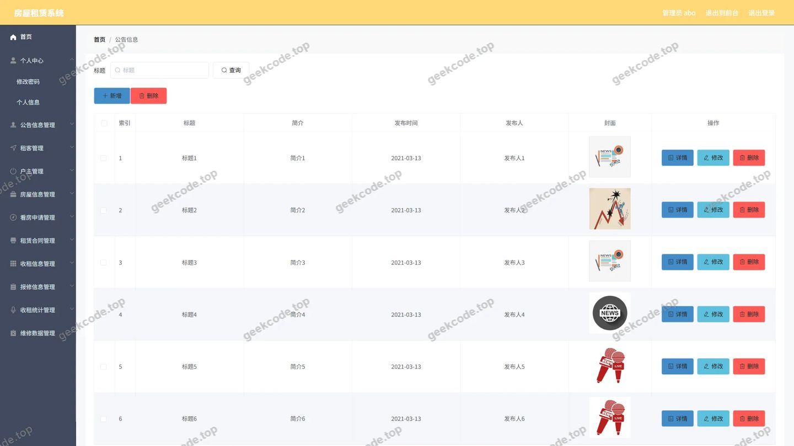</a>

<h4>后台首页</h4>

<a href="https://geekcode.top/archives/%E5%9F%BA%E4%BA%8Espringboot%E7%9A%84%E6%88%BF%E5%B1%8B%E7%A7%9F%E8%B5%81%E7%B3%BB%E7%BB%9F?utm_source=github" title="查看完整源码">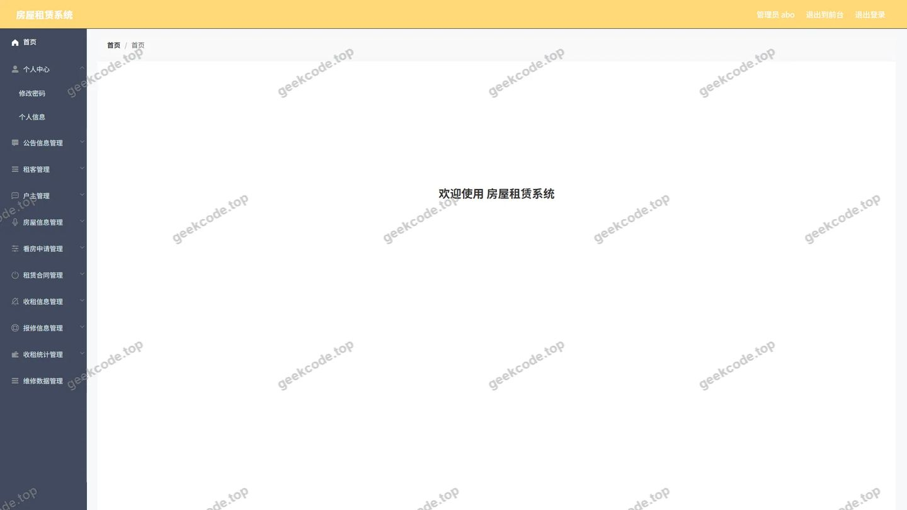</a>

<h4>后台-户主</h4>

<a href="https://geekcode.top/archives/%E5%9F%BA%E4%BA%8Espringboot%E7%9A%84%E6%88%BF%E5%B1%8B%E7%A7%9F%E8%B5%81%E7%B3%BB%E7%BB%9F?utm_source=github" title="查看完整源码">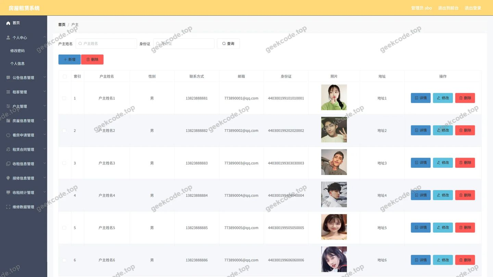</a>

<h4>后台-看房申请</h4>

<a href="https://geekcode.top/archives/%E5%9F%BA%E4%BA%8Espringboot%E7%9A%84%E6%88%BF%E5%B1%8B%E7%A7%9F%E8%B5%81%E7%B3%BB%E7%BB%9F?utm_source=github" title="查看完整源码">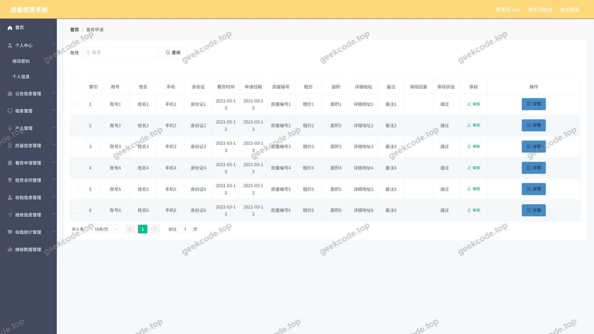</a>

<h4>后台-登录</h4>

<a href="https://geekcode.top/archives/%E5%9F%BA%E4%BA%8Espringboot%E7%9A%84%E6%88%BF%E5%B1%8B%E7%A7%9F%E8%B5%81%E7%B3%BB%E7%BB%9F?utm_source=github" title="查看完整源码">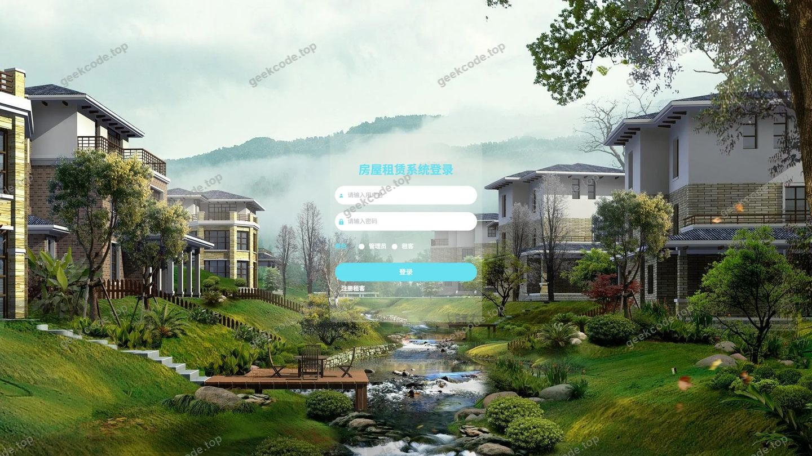</a>

<h4>后台-收租统计</h4>

<a href="https://geekcode.top/archives/%E5%9F%BA%E4%BA%8Espringboot%E7%9A%84%E6%88%BF%E5%B1%8B%E7%A7%9F%E8%B5%81%E7%B3%BB%E7%BB%9F?utm_source=github" title="查看完整源码">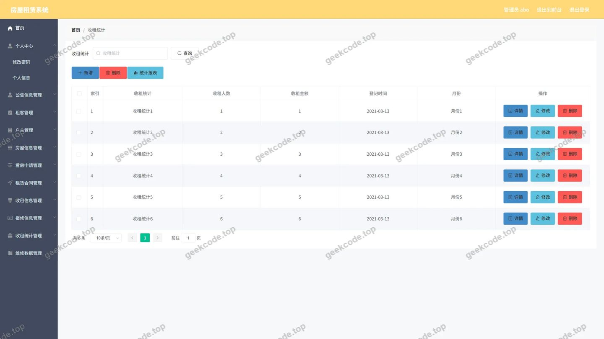</a>

<h4>后台-收租信息</h4>

<a href="https://geekcode.top/archives/%E5%9F%BA%E4%BA%8Espringboot%E7%9A%84%E6%88%BF%E5%B1%8B%E7%A7%9F%E8%B5%81%E7%B3%BB%E7%BB%9F?utm_source=github" title="查看完整源码">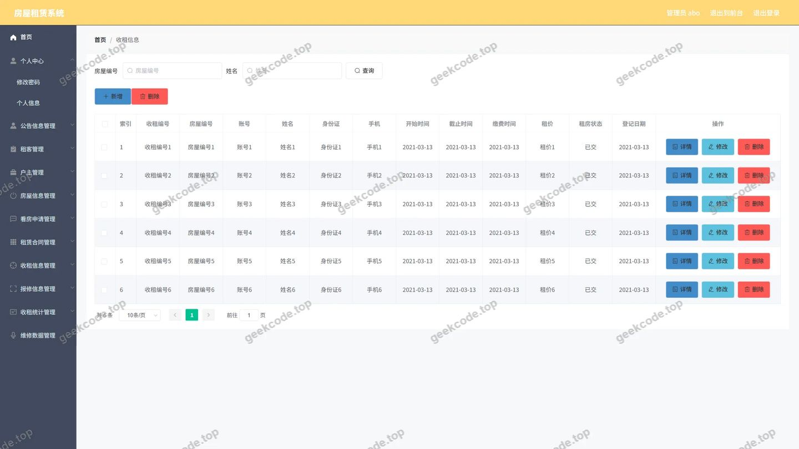</a>

<h4>后台-维修数据</h4>

<a href="https://geekcode.top/archives/%E5%9F%BA%E4%BA%8Espringboot%E7%9A%84%E6%88%BF%E5%B1%8B%E7%A7%9F%E8%B5%81%E7%B3%BB%E7%BB%9F?utm_source=github" title="查看完整源码">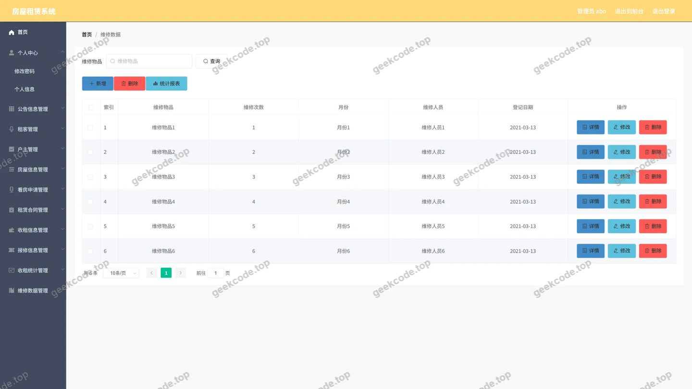</a>

<h4>后台-租客</h4>

<a href="https://geekcode.top/archives/%E5%9F%BA%E4%BA%8Espringboot%E7%9A%84%E6%88%BF%E5%B1%8B%E7%A7%9F%E8%B5%81%E7%B3%BB%E7%BB%9F?utm_source=github" title="查看完整源码">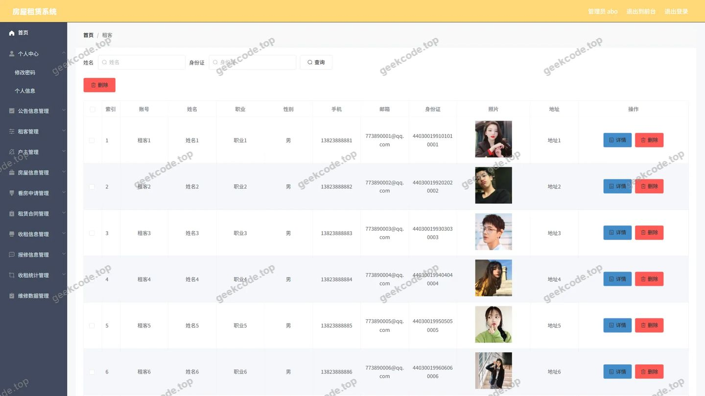</a>

<h4>后台-租赁合同</h4>

---

## 获取完整源码

| 项目 | 说明 |
| --- | --- |
| 项目名 | 基于springboot的房屋租赁系统 |
| 运行截图 | 本文 19 张（站点带水印原图，仓库 `images/` 目录） |
| 完整源码 | [https://geekcode.top/archives/%E5%9F%BA%E4%BA%8Espringboot%E7%9A%84%E6%88%BF%E5%B1%8B%E7%A7%9F%E8%B5%81%E7%B3%BB%E7%BB%9F?utm_source=github](https://geekcode.top/archives/%E5%9F%BA%E4%BA%8Espringboot%E7%9A%84%E6%88%BF%E5%B1%8B%E7%A7%9F%E8%B5%81%E7%B3%BB%E7%BB%9F?utm_source=github) |
| 咨询微信 | **ir9372**（备注：jingpin-yuanma） |
| 更多项目 | [极客代码 geekcode.top](https://geekcode.top/?utm_source=github) |

> 需要源码、部署、改配置、跑不起来等问题，加微信 ir9372 沟通，说明项目名即可。
